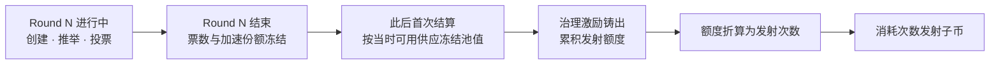
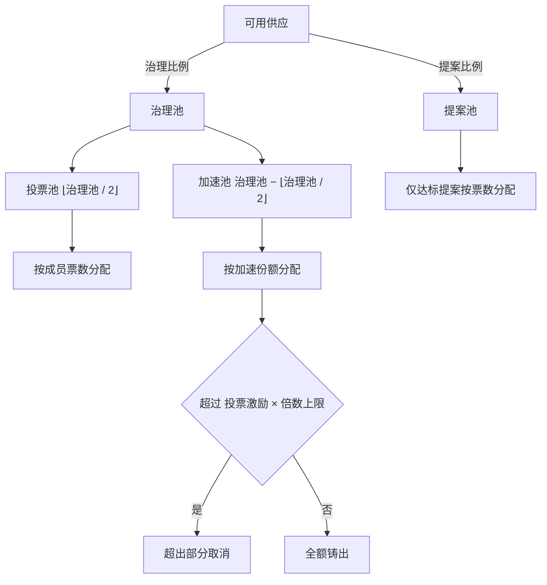
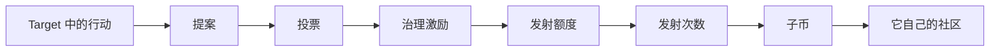

# LOVE20 Core: A Decentralized Community Minting Protocol

**去中心化社群铸币协议 · 核心篇**

**Abstract.** A community can mint a currency only if someone holds the right to issue it. Existing systems return that right to a founding team, to a committee, or to whoever arrives first with capital. We propose a protocol in which the right to issue is derived from verifiable community action rather than granted by an issuer. Members stake liquidity for time-weighted votes, vote on proposals that commit to on-chain actions, and receive a governance reward that converts into a bounded number of issuance rights. Identity is an NFT whose mint price is paid in the protocol's first token and burned; each round's reward pool is frozen before it is spent; the supply ceiling is never exceeded; fees are burned rather than distributed. No administrator, upgrade path, or off-chain component exists. Issuance thereby becomes a quantity anyone can recompute, not a discretion anyone can exercise.

---

## 1. 引言

铸币权是价值分配的主导权。谁决定新币发给谁，谁就决定了社群把资源投向哪里。

比特币 [1] 第一次证明，一群互不相识的人可以仅凭共识铸造出有价值的资产，不需要机构背书、实体支撑或商业营收。它回答的是「谁能发行」：任何人，只要付出计算。它没有回答的是「发行给谁、发行多少、由谁决定」——在比特币里，这三个问题由算力回答，而算力可以被资本集中。

此后的三次尝试各缺一环。ICO 与 VC 币把发行权交回创始团队，预留、私募与解锁表让社群铸币退化为项目方铸币；DAO 把治理交给持币者，实践中却被多签、大户与做市商俘获，国库成为新的中心；MEME 用公平发射解决了起点，却没有解决起点之后——没有任何机制把持续的社群行动折算成持续的发行。

本文描述 LOVE20 的核心层协议：一套按轮次推进的去中心化社群治理框架。它只做四件事：流动性质押取得治理票，治理票用于对提案投票，投票结果决定铸币激励，累计的治理激励折算成子币发射权。行动的真伪由 Target 合约自证；核心层只保证三件事——票数不可重复使用，激励不可超发，发行权只能由参与记录累积。

第 2 至 3 节给出身份与时间两个基础；第 4 至 5 节说明票权与流动性如何互换；第 6 至 8 节是投票与铸造；第 9 节把激励换成新币；第 10 至 11 节讨论激励相容与信任边界；第 12 节结论。

## 2. 身份

业务状态需要一个可以转移、无法伪造的载体。地址是免费的，因此不能作为身份：否则提案名额可以被无限制造，身份也就失去意义。

会员身份是一枚 ERC-721 NFT [2]，编号从 1 起单调递增、永不复用。质押、投票、发射次数全部记在身份编号下，而不是地址下。地址只是当前的持有者；转移 NFT 即转移全部未结算权益，历史记录不随转移改写。

身份有价，费用以首币计价并立即销毁：

```text
未铸供应 = 最大供应 − 已铸供应
基础价格 = ⌊未铸供应 / 除数⌋
铸造价格 = 字节长度 ≥ 阈值
         ? 基础价格
         : 基础价格 × 倍数^(阈值 − 字节长度)
```

短名更贵，因为名字是有限的社会资源。价格随首币的未铸供应下降：首币越接近供应上限，新增身份越便宜。销毁而非归集，意味着这笔费用不流向任何主体，只减少流通量。

名称支持中文、英文与数字；判重时英文不分大小写，其余字符按原样比较。名称长度有上限，示例为 32 字节。

## 3. 时间

治理需要一个所有社区共用的节拍。Phase 是与业务无关的时间片：从部署时给定的起始区块起编号，目标时长固定（例如一天）。公链的出块间隔并非恒定，若时间片按固定区块数切分，实际时长就会随出块变快而不断缩短——从一天变成半天、一小时、十分钟甚至一分钟，最终短到一轮无法完成提案与投票，协议也就无法使用。因此每个时间片任何人均可触发一次同步，记录当期的区块高度与时间戳；只有当实测偏差超过阈值时，才依据观测记录调整后续时间片的长度，让实际时长围绕目标值波动。调整不改变已经过去的边界，也不能让同一个时间片获得第二次同步机会。

核心层把时间片直接读作治理轮次：Phase N 就是 Round N，Round 0 不存在。轮次是唯一的冻结点——轮末之后，本轮票数与加速份额不再变化，所有结算都发生在轮末之后。



轮次不规定业务阶段。行动层可以在自己的阶段开放参与与验证，核心层只负责在轮末冻结结算所需的两组数字：票数，与加速份额。

## 4. 质押

票权不能只来自持币，否则大户可以在投票前瞬间买断治理。票权来自两样东西：为社区提供流动性的份额，以及承诺不撤出的时间。

```text
治理票 = 流动性份额 × 承诺解锁期
```

承诺解锁期以轮为单位。同样的流动性，把承诺解锁期从一轮提高到两轮，票权翻倍。票权随质押变动：追加质押、提高承诺解锁期都立即增加票权。

承诺解锁期不是锁定期。协议没有「到期自动解锁」：只要不申请解锁，质押就一直留在合约里，不会因为时间过去而自动释放。承诺解锁期只在申请解锁之后才开始计时——申请的那一刻票权归零，此后不能再投票，也就不再产生新的治理激励；已经投过票的轮次仍按当时的记录结算。等满承诺解锁期，才能取回资产。它描述的是「申请后还要等多久」，不是「多久后自动放行」。等待期内 NFT 仍可转让，受让人继承剩余等待时间。

流动性质押投入的是社区代币与父币（均为 ERC-20 代币 [3]）组成的恒定乘积池 [4] 的 LP。份额按 LP 计，但必须先在手续费重分类之后计算——否则新存入者会分走旧质押者已经累积的池费。

加速质押共用同一段承诺解锁期，是第二种可存入资产：成员把社区代币与 LP 一同存入，用于参与治理池中的加速部分。它本身不产生票权。只有在同时提高承诺解锁期时，才按「流动性份额 × 承诺解锁期增量」增加票权。这条区分很重要：加速份额买不到票，只能买到加速激励的分配权重。

## 5. 手续费与销毁

恒定乘积池的 LP 份额会随交易费增加而升值。多数协议把这部分升值留给质押者；本协议把它全部销毁，质押者的回报来自治理激励与发射权，而不是池费。

每次流动性变动或结算之前，先把池子自上次结算以来的增值从「可提取 LP」中剥离为「手续费 LP」：

```text
当前基准 = ⌊√(储备0 × 储备1) × 记账 LP 总量 / 池子 LP 总供应⌋
新可提取 = ⌊上次可提取 × 上次基准 / 当前基准⌋
手续费   = 记账 LP 总量 − 新可提取
```

剥离之后，同样数量的新存入会得到更多份额。手续费从可提取量中剥离、最终全部销毁，不归旧质押者，本金不受影响。

真正的取回与销毁受两条约束。第一，每个社区每个时间片至多结算一次，否则同一笔交易内重复调用就能把额度刷完。第二，单次只处理一个阈值单位：

```text
结算单位 = ⌊可提取 LP / 分母⌋
触发条件 = 手续费 LP ≥ 结算单位
单次处理 = 结算单位
```

取出这一单位对应的双币，社区代币直接销毁，父币按固定路径 [5] 换成社区代币后销毁。单次价格移动不超过 `1/分母`；只要分母不小于池费率的倒数，一次往返的夹子利润就盖不过两倍池费。以 3/1000 的池费率为例，分母至少取 334；示例配置即取下界，单次价格移动约 0.3%，不超过一个池费。这个参数是夹子敞口的尺度，不是 MEV 防护——跨交易的夹子被限制，而不被消除。

手续费不分红，是这套设计的核心取舍：流动性提供者用现金流换治理权重，社群用治理权重换流动性深度。

## 6. 提案

一个提案承诺一段可以长期保存的文本，指定一个接收激励的 Target，并可附带一段由 Target 解释的数据。核心层不解释 Target 的业务，也不检查行动是否发生——那是 Target 自己的账本。

提案一经创建即长期存在，可在之后每一轮被重新推举。推举是进入本轮投票的唯一入口：每个成员每轮一个名额，每个提案每轮至多被推举一次，每个社区每轮至多一千个提案。

推举有门槛：推举者的票权必须达到社区总票权的 0.3%（示例配置）。

```text
成员票权 / 社区总票权 ≥ 推举门槛
```

门槛是一个比例，示例为 0.3%。它的作用不是筛选质量，而是给「制造提案」标价。票权来自质押与承诺解锁期，因此提案名额不能被无成本地批量生产。

Target 有两种模式：不回调，或在本轮创建、推举、投票三个时点各回调一次。回调数据对核心层不透明，原样透传；回调失败则整笔回滚。行动类 Target 由此可以在投票发生时即时记账，而不必等轮末。

## 7. 投票

投票决定行动的激励份额。成员把本轮票权分配给若干已推举的提案，同一轮内可以多次投票，累计不超过当前票权。

与票数同时被记录的还有加速份额。首次投票时记入全部加速份额，此后只补记正增量；没有继续投票的追加质押不进入本轮快照。轮末之后，票数与加速份额一起冻结，成为下一节唯一的计算依据。

冻结的意义在于可复算：任何人都能在轮末之后，用同一份链上状态重算每个成员应得的每一笔激励，不依赖事件或链下索引。投票时 Target 收到的增量票数可以由它自己记账，但不影响核心层的计算。

## 8. 激励铸造

每轮结束后，协议把「可用供应」的一部分注入两个池：治理池与提案池。

```text
可用供应 = 最大供应 − 已铸供应 − 尚未结算的预留
治理池   = ⌊可用供应 × 治理比例⌋
提案池   = ⌊可用供应 × 提案比例⌋
预留    += 治理池 + 提案池
```

这是每轮唯一增加预留的地方。账本恒满足：

```text
预留 ≥ 已铸 + 已取消
```

预留一旦写入，只会出现三种结果：被铸出、被取消、或永久停留在未结算状态（见后）。取消的额度不在本轮铸出，也从未进入流通，因此它占用的供应容量回到可用供应，留待以后轮次重新预留；同一笔额度不会在同一轮既铸造又取消。整数除法向下取整，未分配的零头不会被单独铸造。以示例参数计，治理池与提案池各取可用供应的 0.05%，合计 0.1%；若每轮结算完毕，距供应上限的差额约每六百九十轮减半。

池值在本轮第一次结算时冻结：冻结之前，它只是按当前供应算出的投影；冻结之后，它才成为可分配的确定数额，不再随供应变化。若本轮没有任何票，两个池都记为零；若本轮没有任何加速份额，加速池在冻结时直接取消；若没有任何提案达到门槛，整个提案池在冻结时取消。被取消的池值不在本轮铸出，也不作为池值结转到下一轮。



治理池固定对半分为投票与加速：

```text
投票激励 = ⌊投票池 × 成员票数 / 全轮票数⌋
理论加速 = ⌊加速池 × 成员加速份额 / 全轮加速份额⌋
加速激励 = min(理论加速, 投票激励 × 倍数上限)
取消     = 理论加速 − 加速激励
```

加速激励不得超过投票激励的若干倍，这是治理池里唯一的反资本上限。没有它，纯资本可以买断加速池；有了它，加速份额的边际回报在超过上限后归零，超出部分取消，不进入流通。未投票者即使有加速份额也拿不到治理激励——加速权重只在投票时被记入。

提案池只在本轮达到门槛的提案之间分配（示例门槛为全轮票数的 3%）：

```text
达标 = 提案票数 > 0 且 提案票数 ≥ 全轮票数 × 提案门槛
单个提案激励 = ⌊提案池 × 提案票数 / 达标提案票数之和⌋
```

每个提案只能结算一次，且只能由它自己的 Target 触发，代币直接铸给 Target 指定的收款地址。Target 可以指定行动的执行者，因此激励不必先经过 Target 再转一手。

结算额为零时拒绝结算，而不是写入一条零记录。这保证「已结算」只能由一次真实支付产生，不能被空调用占位。

无法分配的激励既不会被铸出，也不会被取消：某个行动如果最终没有可接收的人，对应额度永久停留在未结算状态，预留不释放，后续轮次的可用供应因此被压低，代币永不铸出。这是有意的：取消需要有人负责，而核心层不判断一笔激励该不该作废。

## 9. 发射权与代币树

激励解决「谁得到了价值」，发行解决「谁可以创造下一代」。两者由一本额度账连接。

每次治理激励实际铸出后，同一笔金额在未达上限时累积为发射额度。额度不是额外的代币，而是「你过去参与治理所换得的激励」的记录；代币已经在成员手里，转换时只消耗记录，不转移代币。

```text
阈值 = ⌈(最大供应 − 本次铸造前已铸) × 发射比例⌉
次数 = min(⌊额度 / 阈值⌋, 社区次数上限 − 已产生次数)
额度 −= 次数 × 阈值
```

阈值与未铸供应同比例变化：社群越接近供应上限，一次发射所需的额度越少。发射权因此不是固定价格的门票，而是随社群成熟变便宜的历史凭证。

次数上限每社区固定（例如一千次），消耗与融合都不释放上限。额度可以累积、可以跨轮结转，随身份转移，但不参与融合；次数随身份转移，也可以在两个身份之间融合。融合不改变任何历史记录，只搬运可用次数。

协议没有国库，也不为自己保留份额。首币的首批供应直接进入分发地址，此后每个子币的首批供应由发射者指定去向，核心层不留任何额度。

代币树以根父币（链的包装原生币，例如 BSC 上的 WBNB）为根。首币在初始化时创建并登记，父币为根父币，不消耗任何人的发射次数。首币每产生一次发射次数，同一笔内按 1:1 记入根父币维度的根级次数。根级次数只能发射与首币平级、父币同为根父币的同级币，其他代币产生次数时不伴生。这让根级发行自动有界：根级累计恒等于首币累计，且同样受次数上限约束。

每个代币都是一个独立社区：身份是全局的，质押、提案、投票与激励按代币分别记账，子币不继承父币的任何治理状态。

```text
根父币
├── 首币 ─── 子币 ─── 子币
└── 同级币 ─ 子币
```

子币的符号全局唯一、长度固定，按 UTF-8 字节计，汉字占三字节，因此符号本身就是代币树上的唯一标识。每次发射在同一笔交易内创建代币、创建或复用它与父币的恒定乘积池、把首批供应交给发射者指定的分发地址，然后扣减一次次数。发射者可以选择回调式分发，让接收方在链上自行领取。



## 10. 激励相容

一套机制只有在每个参与者按规则行事都比偏离更有利时，才是稳定的。以下逐项说明各角色的最优选择为何与设计一致。

**身份。** 铸造身份要销毁首币，价格与首币的未铸供应挂钩。首币的未铸供应越多，身份越贵——这恰好让批量制造身份在社群最脆弱时代价最高。身份不能增加票权：票权只由质押份额与承诺解锁期决定，把一个仓位拆成十个身份，总票权不变。拆分在治理上唯一的收益是每轮多出九个提案名额，而每个名额都要独立跨过 0.3% 的推举门槛；门槛按社区总票权计算，不按身份计算。

**长期。** 票权等于份额乘承诺解锁期，把时间写进权重。承诺解锁期不是锁定期：只要不申请解锁，质押会一直留在合约里；申请解锁后票权立即清零，此后不再产生新的治理激励，还要等满承诺解锁期才能取回。短线资本即使买下大量 LP，也要么接受最短承诺解锁期，要么承诺更久；要获得与长期成员相同的票权，必须同样放弃随时退出的能力。

**资本。** 加速激励的上限让纯资本无法买断治理池。设倍数上限为 M、某成员的投票激励为 v，则其加速激励不超过 M·v；当 M 为 2 时，即使某人持有全部加速份额，其加速收益也只是自己投票收益的两倍，而不是全池。超出部分取消，不转移给他人。

**提案。** 提案池只在达到门槛的提案之间分配，门槛按全轮票数计算。这使「大量小额提案瓜分池子」无利可图：每个提案都要独立获得全轮票数的固定比例，票只能从其他提案手里抢。每社区每轮一千个提案的上限，进一步把单轮的计算规模钉死在有限范围。

**发行。** 发射权没有独立的出售入口：它只能由治理激励累积，并随身份转移。治理激励只能由投票获得；投票权只能由质押与承诺解锁期获得。这条链条上没有任何一环可以用钱直接跳过——钱可以买到份额，但买不到随时退出的自由：票权要用承诺解锁期换。

**流动性。** 手续费不分红，全部销毁。质押者放弃池费，换到票权、加速激励与发射权。这个交换是否划算由成员自行判断：池费高于治理回报时，质押流出，流动性变薄，单位票权变贵；反过来则吸引更多质押。协议不承诺均衡，只保证交换的条款对所有人一致。

## 11. 信任边界

这套系统不依赖管理员、升级入口或链下组件。合约部署后没有 owner，没有暂停开关，没有可替换的模块；参数在初始化时固定。任何「升级治理」的路径都不在协议内，但框架可以扩展：新的行动类型只需实现 Target 接口，就能接入同一套投票与结算，不需要改动核心合约。实现基于公开的标准库 [6]，没有私有依赖。

它依赖三件事。

第一，行动由 Target 自证。核心层只把票数折算成激励，不检查激励对应的行动是否发生。一个 Target 若把激励发给不该拿的人，核心层不会阻止；它只保证同一个提案不会被支付两次。行动层的安全性由各 Target 自己的账本承担。

第二，部署的正确性由社区校验，而不由部署者声明。初始化入口不限制调用者，因此任何人都可能先调用；但先调用不产生权威。社区校验的是最终结果：依赖地址、首币参数、供应量与各项配置是否与公开的部署参数一致。这套校验可以被任何人重放，也不需要信任部署者。校验不通过的合约不会被采纳；抢先初始化一份错误配置的副本，不会带来任何收益。部署与初始化可以分两笔交易完成，信任来自可复核的结果，而不是交易时序。

第三，票权随头寸转移。NFT 可以自由转让，转让即转让票权与未结算权益；协议不阻止「卖出再买回」式的场外票权租借。它能保证的是同一份质押在同一轮不被使用两次：已投票或已推举的仓位不能融合，已投出的票数计入身份额度，转让不会重置额度。

舍入不构成信任假设，但同样会沉淀价值：除发射阈值向上取整外，所有除法向下取整，余数不单独铸造、不补发、不追缴。这让账本始终闭合，代价是极小量的价值永久沉淀。

## 12. 结论

我们描述了一个把铸币权变成计算结果的协议。身份有价、费用销毁，票权由流动性乘承诺解锁期得出，每轮激励在花出去之前就已冻结，提案只有跨过票数门槛才能分到钱，而发行下一代代币的权利只能由过去为行动投票的记录累积而来。没有任何一个环节需要发行方裁量：给定链上状态，每个数字都可以被任何人重算。

比特币证明了社群可以铸币。它没有回答的是，铸币之后，谁来决定下一枚币发给谁。核心层给出的答案是：让投票与结算本身成为发行权的来源。

## 附录 A 部署参数

以下为部署配置的示例取值，不是协议常量。协议只要求各参数落在有效范围内，具体数值由部署者选定并在初始化时固定。

| 参数 | 含义 | 示例值 |
| --- | --- | --- |
| 时间片目标时长 | 每个治理轮次的目标自然时长 | 86400 秒（1 天） |
| 时间片偏差阈值 | 触发时长校准的相对偏差 | 部署时确定 |
| 身份费用除数 | 未铸供应到基础价格的除数 | 1 亿 |
| 短名阈值 / 倍数 | 低于该字节数开始加价；每少一字节的倍数 | 7 字节 / 10 |
| 名称最大长度 | 身份名称的字节上限 | 32 字节 |
| 推举门槛 | 推举者票权占社区总票权的比例 | 0.3% |
| 提案激励门槛 | 提案票数占全轮票数的比例 | 3% |
| 治理池 / 提案池 | 每轮从可用供应中预留的比例，两池各占一半 | 各 0.05%，合计 0.1% |
| 加速倍数上限 | 加速激励相对投票激励的倍数上限 | 2 |
| 发射比例 | 折算一次发射次数所需的未铸供应比例 | 1% |
| 每社区次数上限 | 一个社区累计可产生的发射次数 | 1000 |
| 手续费结算分母 | 单次结算量与夹子敞口的尺度 | 334（池费率 3/1000 时的下界） |
| 子币符号长度 | 子币符号的固定字节长度 | 6 字节（两个汉字或六个字母数字） |
| 宿主链 / 池 | 部署环境与恒定乘积池实现 | EVM 兼容链（BNB Smart Chain）/ Uniswap V2 |

## 参考文献

[1] S. Nakamoto, "Bitcoin: A Peer-to-Peer Electronic Cash System," 2008.

[2] W. Entriken, D. Shirley, J. Evans, N. Sachs, "ERC-721: Non-Fungible Token Standard," Ethereum Improvement Proposals, no. 721, 2018.

[3] F. Vogelsteller, V. Buterin, "ERC-20: Token Standard," Ethereum Improvement Proposals, no. 20, 2015.

[4] H. Adams, N. Zinsmeister, D. Robinson, "Uniswap v2 Core," 2020.

[5] Uniswap, "Uniswap v2 Periphery," 2020.

[6] OpenZeppelin, "OpenZeppelin Contracts," 2025.
